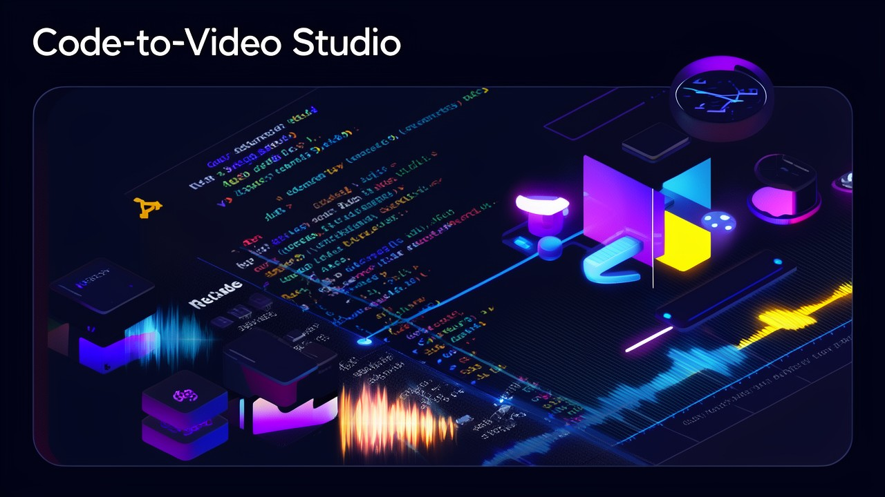
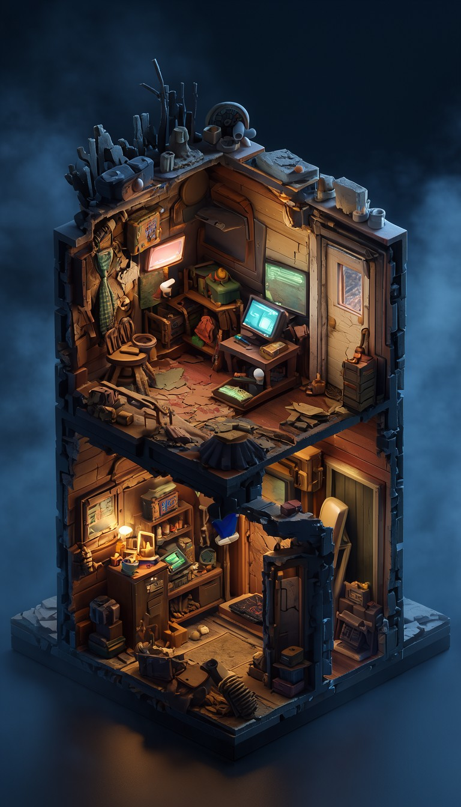
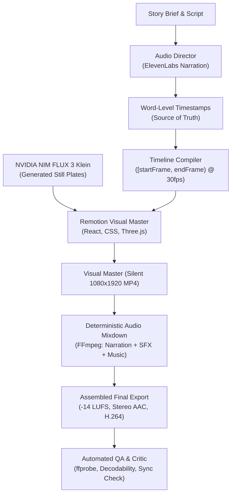

<div align="center">



# Code-to-Video Studio 🎬✨

**The deterministic, code-driven vertical video engine for developers and AI agents.**  
*Programmatic 9:16 Shorts & Reels powered by React, Remotion, ElevenLabs audio timing, and NVIDIA NIM image generation.*

[](LICENSE)
[](https://nodejs.org/)
[](https://pnpm.io/)
[](https://www.remotion.dev/)
[](https://www.typescriptlang.org/)
[](AGENT_README.md)

[Quick Start](#-quick-start) • [Why Code-to-Video?](#-why-code-to-video-studio) • [Production Modes](#-production-modes) • [Architecture](#-architecture) • [CLI Reference](#-cli-reference) • [Agent Integration](AGENT_README.md)

</div>

---

## 💡 Overview

Generative AI video models frequently suffer from unpredictable pixel-morphing, hallucinated subtitles, drifting layouts, and poor timing control. 

**Code-to-Video Studio** takes a fundamentally different, developer-first approach: **Code-driven animation with audio-first synchronization**.

Instead of hallucinating video frames, Code-to-Video Studio:
1. Uses **finalized speech narration** (via ElevenLabs) with word-level timestamps as the **absolute source of timing truth**.
2. Renders dynamic scenes using **React & Remotion**, Three.js rigs, kinetic typography, and canvas layers.
3. Incorporates **cinematic AI still plates** (via hosted NVIDIA NIM FLUX 3 Image Klein) as backgrounds and environment layers, animated via code.
4. Deterministically mixes sound effects, ducked background music, and stereo audio to standard broadcast loudness (−14 LUFS) with **FFmpeg**.
5. Validates every export with **strict automated QA metrics** and immutable SHA-256 artifact manifests.

Whether you are building automated TikTok/YouTube Shorts pipelines, data explainers, or deploying autonomous bot teams in [OpenMausBot](https://github.com/milind-soni/OpenMausBot), Code-to-Video Studio gives you 100% reproducible, pixel-perfect output every time.

---

<div align="center">
  
  <p><i>Example: High-fidelity diorama background plate generated with NVIDIA NIM FLUX 3 Klein for the <code>isometric-art-zombie-apocalypse</code> story mode.</i></p>
</div>

---

## ✨ Key Features

| Feature | Description |
|---|---|
| 🎙️ **Audio-First Timing Authority** | Word-level timestamps calculate integer frame ranges `[startFrame, endFrame)` at 30 fps. Subtitles and transitions hit exactly on cue. |
| ⚛️ **React & Remotion Motion** | Build scenes with standard React, TypeScript, CSS, SVG, and `@remotion/three`. No flaky black-box AI video hallucinations. |
| 🎨 **Still Generation via NVIDIA NIM** | Generate ultra-crisp atmospheric plates (FLUX 3 Image Klein) on demand, cached by prompt hash and animated via code. |
| 🎛️ **Deterministic Audio Finishing** | Multi-track audio mixdown: auto-ducking music beds, sound effect cueing, and loudness normalization to −14 LUFS via FFmpeg. |
| 🧩 **Pluggable Production Modes** | Ship with general explainers and specialized story modes, or build custom series modes with our automated mode migration engine. |
| 🤖 **Built for AI Agents** | Headless CLI, strict JSON input/output contracts, zero unhandled errors, built-in preflight `doctor`, and sandboxed execution. |
| 🛡️ **Zero-Drift Determinism** | Pinned seeds, font bundles (Inter OFL), source fingerprinting, and cryptographic reproducibility records for every render. |

---

## ⚡ Quick Start

### Prerequisites
* **Node.js**: >= 24.5.0
* **pnpm**: >= 10.33.0
* **FFmpeg & ffprobe**: Installed and available on your system `PATH`
* **Git**: Installed

### 1. Installation

```bash
git clone https://github.com/AneekRahman/code-to-video-studio.git
cd code-to-video-studio
pnpm install --frozen-lockfile
```

### 2. Prepare Environment & Verify

Download the Remotion headless browser and run preflight diagnostics:

```bash
pnpm studio prepare-browser
pnpm studio doctor
```

`pnpm studio doctor` verifies Node, proxy configuration, FFmpeg filters, codecs, render browsers, writable directories, and optional API keys.

### 3. Run a Sample Fixture Video

Render a complete test video immediately without requiring external API keys:

```bash
pnpm fixture --out work/fixture
pnpm studio run --job work/fixture/job.json --out work/outputs
```

Output video and artifacts will be generated in `work/outputs/`!

---

## 🎬 Production Modes

Every video job runs in a registered **Production Mode**. Modes standardize art style, visual composition, camera movement, and audio direction.

```bash
# List all registered modes and their capabilities
pnpm studio modes
```

### Shipped Modes

1. **`explainer` (Fallback Mode)**
   * **Purpose:** Kinetic typography, data callouts, statistics, lists, comparisons, and educational shorts.
   * **Visuals:** Code animations, responsive caption cards, metric badges, and accent graphics.
   * **Default:** Used whenever no specialized mode fits the brief.

2. **`isometric-art-zombie-apocalypse` (Cinematic Story Mode)**
   * **Purpose:** 30–60 second narrative suspense shorts (3D clay characters escaping danger, emergency broadcasts, survival rules, and uncanny twists).
   * **Visuals:** Atmospheric isometric diorama plates generated via NVIDIA NIM FLUX 3 Klein, with 3D clay rigs animated via `@remotion/three`.
   * **Audio:** ElevenLabs narration with word timing, synchronized emergency broadcast audio, 40+ sound effects, and tension score.

### Creating New Modes

```bash
# Validate a new mode interview request
pnpm studio check-mode-request --request path/to/request.json

# Scaffold a workspace mode from templates
cp -r templates/local-mode local-modes/my-new-series
```

Workspace modes live in `local-modes/<id>/` and declare their API version (`api: 1`). Upgrades across breaking studio releases are handled automatically with:

```bash
pnpm studio migrate --dry-run
pnpm studio update --to v<release>

# Inspect and prune scratch files older than 48h
pnpm studio prune --older-than 48
```

---

## 🏗️ Architecture



---

## 🛠️ CLI Reference

All commands run through `pnpm studio <command>`:

| Command | Description |
|---|---|
| `doctor` | Verify host prerequisites (Node, FFmpeg, encoders, proxy, keys, browser). |
| `modes` | Print the published catalog of shipped and local modes. |
| `schemas` | Export JSON schemas for jobs, plates, stories, sounds, and manifests. |
| `validate --job <file>` | Validate a job manifest against schema and asset integrity. |
| `compile --job <file>` | Compile integer-frame timeline from narration timestamps. |
| `preview --job <file> --out <dir>` | Render half-resolution preview MP4 and contact sheet. |
| `render --job <file> --out <dir>` | Render silent full-resolution 1080x1920 visual master. |
| `finish --job <file> --out <dir> --visual-manifest <file>` | Execute FFmpeg audio finishing and mixdown. |
| `run --job <file> --out <dir>` | Execute complete render and audio finishing pipeline. |
| `verify --result <dir>` | Run technical validation and decodability checks on export. |
| `generate-plates --plates <file> --out <dir>` | Generate still background plates via NVIDIA NIM FLUX 3 Klein. |
| `generate-audio --story <file> --sound <file> --out <dir>` | Generate ElevenLabs narration, word timing, SFX, and music. |
| `package-story --story <file> --sound <file> --plates <dir> --audio <dir> --out <dir>` | Assemble story components into a runnable job directory. |
| `migrate [--dry-run]` | Inspect and apply automated mode migration codemods. |
| `update --to <tag>` | Safely update studio to a newer release with automated mode migrations. |

---

## 🔑 Environment & Credentials

Without `local.env`, generation automatically uses the IAM-authenticated
`openmausbot-generation-v1-generate` backend; AWS CLI, scoped AWS credentials
and `--job-id` are required. See [backend setup and supported inputs](docs/generation-backend.md).
An existing file keeps the local-provider path.

For local generation, credentials are read from the git-ignored `local.env` file (permissions `600`) or environment variables:

```bash
# local.env
NVIDIA_NIM=nvapi-your-nvidia-nim-api-key
ELEVENLABS=your-elevenlabs-api-key
```

> **Security Note:** Provider keys are never logged, printed, or committed into git. Production jobs reference provider configurations by name, never inline secrets.

---

## 🤖 AI Agent Integration

Code-to-Video Studio is designed specifically for autonomous AI agents (Claude Code, OpenAI Codex, Antigravity, Cursor, and OpenMausBot).

See [`AGENT_README.md`](AGENT_README.md) for full agent prompts, autonomous installation recipes, error troubleshooting matrices, and schema definitions.

---

## 📜 License

* **Code-to-Video Studio core:** Licensed under the [MIT License](LICENSE).
* **Remotion:** Licensed separately under the [Remotion License](https://www.remotion.dev/license).
* **Typography:** Bundled Inter font is licensed under the [SIL Open Font License (OFL)](https://openfontlicense.org/).
